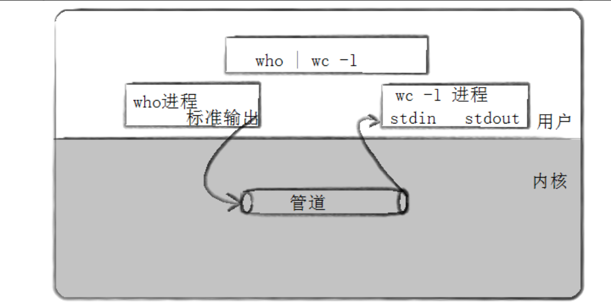
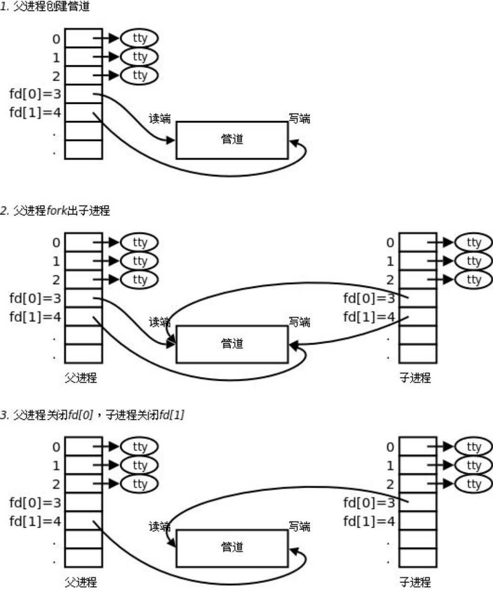
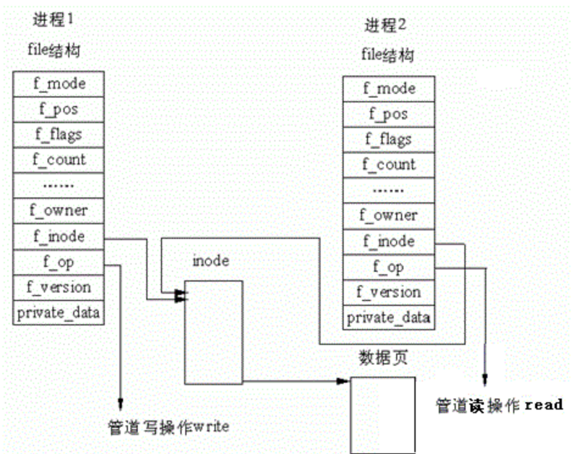
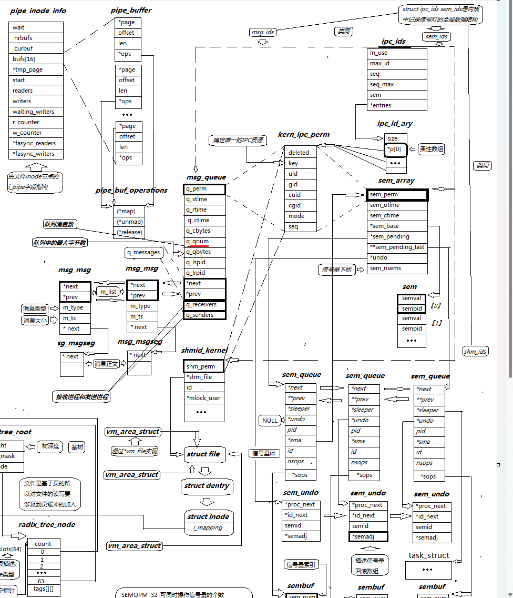

>**作者**：yuuki233233
>**目标**：德国 CS 本科 + 特斯拉软件工程师
>
>进程具有独立性，每个进程都有自己独立的虚拟地址空间。这就意味着，一个进程是无法直接访问另一个进程的数据的。那如果我们需要它们互相配合怎么办？这就是**进程间通信（IPC, Inter-Process Communication）** 要解决的问题

# 为什么需要进程间通信

进程间通信主要有四个目的：
1. **数据传输**：一个进程把数据发送给另一个进程
2. **资源共享**：多个进程共享同一份资源
3. **通知事件**：比如子进程退出时给父进程发送 `SIGCHLD` 信号
4. **进程控制**：如 Debug 进程拦截另一个进程的异常

# 什么是管道（Pipe）

管道我时 Unix 中最古老的 IPC 形式。我们在 shell 中经常用：`who | wc -l`。这里的  `|` 就是一个管道。它的作用是把前一个进程的标准输出（stdout），直接作为后一个进程的标准输入（stdin）

**管道的本质**：操作系统在内核中开辟的一块**缓冲区**。数据从一端写进去，从另一端读出来

# 一、匿名管道（Anonymous Pipe）



使用 `pipe()` 系统调用创建：
```c
#include <unistd.h>
int pipe(int fd[2]);
```
- `fd[0]`：指向管道的读端
- `fd[1]`：指向管道的写端
- 返回值：成功返回 0，失败返回 -1

**核心特质**：
- **半双工**：数据只能单向流动（要么读要么写）。要实现双向通信，必须建两根管道
- **随进程**：管道在内存中，进程退出，管道文件描述符被回收，管道也就销毁
- **自带同步互斥**：当管道没数据时，`read` 会阻塞。当管道写满（通常是 64 KB）时，`write` 会阻塞
- **生命周期**：基于文件描述符，所以只能用于具有亲缘关系（如父子进程）的通信

## 1.1 为什么父子进程能通过管道通信

单独一个进程调用 `pipe()` 只能自己写自己读。要通信，必须配合 `fork()`
1. 父进程创建管道，得到 `f[0]` 和 `f[1]`
2. 父进程 `fork()` 出子进程。因为子进程会拷贝父进程的文件描述符表，所以子进程也拥有 `f[0]` 和 `f[1]`，并且**指向内核的同一个管道**
3. 为了实现单向通信，父进程关闭 `f[0]`（读），子进程关闭 `f[1]`（写）
4. 于是，父进程写，子进程读。管道一下就通了

<div align="center">
<br>
  
  <p style="color: gray; font-size: 14px; margin-top: 8px;">
    实例图：站在文件描述符表角度理解管道
  </p>
</div>

## 1.2 底层视角：一切皆文件

为什么管道可以用 `read` 和 `write` 操作？
因为在内核中，管道被抽象成了文件。父进程和子进程的 `struct file` 同时指向了同一个 `inode`。只不过这个 `inode` 指向的不是磁盘，而是内核内存中一块缓冲区（Pipe Buffer）
- **写端**：将数据拷贝到内核缓冲区
- **读端**：从内核缓冲区拷贝走数据
- 看待管道如同看待文件一样！管道的使用和文件一致，这就是一切皆文件的思想
<div align="center">
<br>
  
  <p style="color: gray; font-size: 14px; margin-top: 8px;">
    实例图：站在内核角度理解管道
  </p>
</div>

## 1.3 管道的 4 种读写情况

1. **读慢，写快**：写端一直写，直到内核缓冲区满，此时写端会阻塞，直到读端读走数据
2. **写慢，读快**：读端一直读，直到内核缓冲区空，此时读端会阻塞，直到写入数据
3. **写关闭，读正常**：所有写端 `f[1]` 被关闭（进程退出）。此时读端读完剩余数据后，再次 `read`  **会返回 0**（代表督导文件尾 EOF）。此时读进程知道通信结束，可以退出
4. **读关闭，写正常**：所有读端 `f[0]` 被关闭。此时写端再执行 `write`，会产生 **`SIGPIPE`** 信号，默认导致写进程崩溃

>[!tip] **注意 PIPE_BUF**：Linux 规定，如果你一次写入的数据量小于 `PIPE_BUF`（通常是 4KB），内核能保证这个写入操作是**原子**的（不会和其他进程的写入交错）。如果大于 4KB，就不保证原子性了

---

# 二、命名管道（FIFO）

## 2.1 为什么需要命名管道

匿名管道靠 `fork()` 继承文件描述符来共享，所以**只能用于有血缘关系的进程**。
如果两个毫无关系的进程（两个独立的可执行程序）想通信怎么办？

答案：**命名管道（Named Pipe / FIFO）**。
它在**文件系统里有一个真实存在的路径和名字**，任何进程只要知道这个路径，就能 `open` 它，从而指向内核里同一个管道对象。

> 一句话：命名管道 = 用「路径的唯一性」替代「fork 的血缘继承」。

## 2.2 创建方式

```bash
# 命令行创建
mkfifo mypipe
ls -l mypipe   # 权限前面会显示 p，表示 pipe
```

```c
#include <sys/types.h>
#include <sys/stat.h>

// 函数创建，mode 受 umask 影响，通常先 umask(0)
int mkfifo(const char *pathname, mode_t mode);
```

## 2.3 命名管道与匿名管道的异同

| 对比项 | 匿名管道 `pipe()` | 命名管道 `mkfifo()` |
| :--- | :--- | :--- |
| 是否有名字/路径 | 无 | **有**，在文件系统里可见 |
| 数据存哪 | 内核内存缓冲区 | 内核内存缓冲区（**不落盘**） |
| 能否跨亲缘进程 | 只能靠 fork 继承 fd | **任意进程**知道路径即可 |
| 需要 flush 落盘吗 | 不需要 | **不需要**（管道文件只被打开，不刷新） |
| 读写语义 | 阻塞、原子性、`read` 返回 0 表示写端全关 | **完全一致** |

> 关键认知：虽然 FIFO 在磁盘上有一个"文件"，但它的大小永远是 0，数据一个字节都不会写到磁盘。这个文件只承担"门牌号"的作用。

## 2.4 打开规则（阻塞点，最容易踩坑）

- 以 **只读 `O_RDONLY`** 打开 FIFO：**阻塞**，直到有另一个进程以写方式打开它
- 以 **只写 `O_WRONLY`** 打开 FIFO：**阻塞**，直到有另一个进程以读方式打开它
- 加 `O_NONBLOCK`：
  - 只读打开：立刻成功返回
  - 只写打开：立刻失败返回 `ENXIO`（因为没读端，写了也没意义）

## 2.5 实战：用命名管道实现文件拷贝

读取文件，写入命名管道
```c
#include <stdio.h>
#include <stdlib.h>
#include <unistd.h>
#include <errno.h>
#include <string.h>
#include <fcntl.h>

#define ERR_EXIT(m) \
do \
{ \
    perror(m); \
    exit(EXIT_FAILURE); \
} while(0)

int main(int argc, char *argv[])
{
    // 创建名为 tp 的命名管道
    if (mkfifo("tp", 0644) == -1) ERR_EXIT("mkfifo");

    // 以读的方式打开 abc 文件
    int infd;
    infd = open("abc", O_RDONLY);
    if (infd == -1) ERR_EXIT("open");
    
    // 以写的方式打开管道 tp
    int outfd;
    outfd = open("tp", O_WRONLY)
    if(outfd == -1) ERR_EXIT("open");

    char buf[1024];
    int n;
    // 数据流动 (文件->缓冲区->管道)
    while((n = read(infd, buf, 1024)) > 0)
    {
        write(outfd, buf, n);
    }
    close(infd);
    close(outfd);
  
    return 0;
}
```

读取管道，写入目标文件
```c
#include <unistd.h>
#include <stdlib.h>
#include <stdio.h>
#include <errno.h>
#include <string.h>
#include <fcntl.h>

#define ERR_EXIT(m) \
do \
{ \
    perror(m); \
    exit(EXIT_FAILURE); \
} while(0)

int main(int argc, char *argv[])
{
    int outfd;
    outfd = open("abc.bak", O_WRONLY | O_CREAT | O_TRUNC, 0644);
    if (outfd == -1) ERR_EXIT("open");

    int infd;
    infd = open("tp", O_RDONLY);
    if (infd == -1) ERR_EXIT("open");

    char buf[1024];
    int n;
    // 数据流动 (管道->缓冲区->备份文件)
    while((n = read(infd, buf, 1024)) > 0)
    {
        write(outfd, buf, n);
    }
    close(infd);
    close(outfd);
    // 删除管道文件
    unlink("tp");

    return 0;
}
```

## 2.6 实战：Server / Client 通信

**server.cc** —— 创建 FIFO，阻塞等客户端，循环读

```cpp
#include <iostream>
#include <cstring>
#include <sys/types.h>
#include <sys/stat.h>
#include <fcntl.h>
#include <unistd.h>

#define FIFO_FILE "./myfifo"

int main() {
    umask(0);
    // 已存在会失败，忽略该错误即可
    if (mkfifo(FIFO_FILE, 0666) == -1 && errno != EEXIST) {
        perror("mkfifo");
        return 1;
    }

    // 1. 只读打开，阻塞等待写端出现
    int fd = open(FIFO_FILE, O_RDONLY);
    if (fd < 0) { perror("open"); return 2; }

    char buffer[1024];
    while (true) {
        // 2. read 返回 0 表示所有写端都已关闭
        ssize_t n = read(fd, buffer, sizeof(buffer) - 1);
        if (n > 0) {
            buffer[n] = 0;   // 手动补字符串结束符，否则 cout 会打印越界垃圾
            std::cout << "client say# " << buffer << std::endl;
        } else if (n == 0) {
            std::cout << "client quit, server exit" << std::endl;
            break;
        } else {
            perror("read");
            break;
        }
    }

    close(fd);
    unlink(FIFO_FILE);   // 删除管道文件
    return 0;
}
```

**client.cc** —— 打开同一个路径写入

```cpp
#include <iostream>
#include <string>
#include <fcntl.h>
#include <unistd.h>

int main() {
    int fd = open("FIFO_FILE", O_WRONLY);
    if (fd < 0) { perror("open"); return 1; }

    std::string line;
    while (true) {
        std::cout << "Please Enter# ";
        std::getline(std::cin, line);
        if (line == "quit") break;
        write(fd, line.c_str(), line.size());
    }

    close(fd);
    return 0;
}
```

**几个必踩的坑**

1. `read` 读到数据后**不会自动加 `\0`**，必须写 `buffer[n] = 0;`，否则 `cout << buffer` 会越界打印乱码。
2. `read` 的第三个参数写成 `sizeof(buffer) - 1`，专门给 `\0` 留一个字节，保证 `buffer[n] = 0` 永不越界。
3. 服务端退出前要 `unlink`，否则下次 `mkfifo` 会因为文件已存在而失败（所以上面用 `errno != EEXIST` 放行）。
4. 客户端 `Ctrl+C` 退出后，`read` 返回 0，服务端要能识别并正常退出，否则会陷入忙等待。

## 2.8 进阶：用两根管道实现链式命令

`cat file | grep xxx | wc -l` 这种三级流水线，本质是：

- 管道 A：连接 `cat` 的写端 → `grep` 的读端
- 管道 B：连接 `grep` 的写端 → `wc` 的读端

三个进程、两根命名管道，配合 `dup2` 把管道的 fd 重定向到各自的标准输入/输出，就能把任意命令串成流水线。这也是 shell 实现 `|` 的原理。

---

# 三、进程池的设计与实现

## 3.1 为什么需要进程池

服务器每来一个请求就 `fork()` 一个进程，代价极高：
- `fork()` 要拷贝页表、文件描述符表（写时拷贝也有开销）
- 进程创建/销毁本身要陷入内核
- 进程数量爆炸后，调度器压力剧增

**进程池（Process Pool）** 的思路：**预先创建好一批子进程，让它们等着，父进程通过管道派发任务。**

> 本质：用「空间换时间」+「复用一个常驻进程」替代「频繁 fork」。

## 3.2 架构设计

```
        Master（父进程）
     ┌──────┬──────┬──────┐
   写端1   写端2   写端3          ← 只保留写端
     │      │      │
   pipe   pipe   pipe            ← 内核缓冲区
     │      │      │
   读端1   读端2   读端3          ← 只保留自己的读端
   Worker Worker Worker           ← 预先 fork 好，死循环 read 任务
```

- **Master**
  - 创建 N 个子进程，为每个子进程建一根管道
  - 保存所有**写端**（用来发任务），关闭所有读端
  - 派发任务时采用**轮询（Round-Robin）**：往第 `i % N` 根管道写一个任务编号
- **Worker**
  - 只保留自己的**读端**，关闭父进程持有的所有写端（关键！）
  - `while(true)` 循环 `read`，读到任务编号就执行对应任务

## 3.3 核心代码

### 1、Channel：一根通道 + 一个子进程

```cpp
class Channel {
public:
    Channel(int wfd, pid_t who) : _wfd(wfd), _who(who) {}

    void Send(int cmd) {
        ::write(_wfd, &cmd, sizeof(cmd));   // 发送任务编号
    }
    void Close() { ::close(_wfd); }
    pid_t Id() const { return _who; }
    int wFd() const { return _wfd; }

private:
    int _wfd;      // 管道写端，父进程用它发任务
    pid_t _who;    // 对应子进程 pid，用于回收
};
```

### 2、ProcessPool：创建 / 派发 / 回收

```cpp
class ProcessPool {
public:
    explicit ProcessPool(int n) : _processnum(n) {}

    int InitProcessPool() {
        for (int i = 0; i < _processnum; i++) {
            int pipefd[2];
            if (pipe(pipefd) < 0) return -1;        // 1. 建管道

            pid_t id = fork();                       // 2. 创建子进程
            if (id == 0) {
                // ---------- 子进程 ----------
                ::close(pipefd[1]);                  // 关掉写端

                // 关键：关掉「历史遗留」的所有写端
                for (auto &c : _channels) c.Close();

                dup2(pipefd[0], 0);                  // 读端重定向到标准输入
                ::close(pipefd[0]);

                Worker();                            // 死循环从 stdin 读任务
                ::exit(0);                           // 绝不 return，防止回主流程
            }

            // ---------- 父进程 ----------
            ::close(pipefd[0]);                      // 关掉读端
            _channels.emplace_back(pipefd[1], id);   // 只存写端
        }
        return 0;
    }

    void DispatchTask(int task) {
        static int who = 0;
        Channel &curr = _channels[who++ % _channels.size()];
        curr.Send(task);                             // 轮询派发
    }

    void CleanProcessPool() {
        for (auto &c : _channels) {
            c.Close();                               // 关写端 → 子进程读到 EOF 退出
            waitpid(c.Id(), nullptr, 0);             // 回收，防僵尸
        }
    }

private:
    std::vector<Channel> _channels;
    int _processnum;
};
```

## 3.4 两个必须理解的坑

### 坑 1：为什么子进程要关闭「历史遗留」的写端？

创建第 3 个子进程时，它会继承父进程当前持有的**所有**已打开的 fd——包括第 1、2 根管道的写端。

如果不在子进程里把这些历史写端关掉：

- 父进程最后在 `CleanProcessPool()` 里关闭自己的写端后
- 第 1 根管道的写端计数**仍不为 0**（因为第 3 个子进程也持有一份）
- 于是第 1 个子进程 `read` 永远等不到 EOF → **永远不退出**
- `waitpid` 永远阻塞 → 程序卡死在清理阶段

所以子进程 fork 出来后，必须立刻 `close` 掉不属于自己的所有 fd。

### 坑 2：父进程必须 `waitpid` 回收

子进程退出后，如果父进程不回收，会留下**僵尸进程（Zombie）**，占用内核 PCB 表项。所以清理阶段一定是「先 close 写端 → 再 waitpid」配对执行。

## 3.5 与线程池的对比

| 对比项 | 进程池 | 线程池 |
| :--- | :--- | :--- |
| 隔离性 | **强**（独立地址空间，一个崩溃不影响其他） | 弱（一个线程段错误，整个进程死） |
| 通信开销 | 大（要走管道/共享内存） | 极小（直接读写全局变量） |
| 创建开销 | 大（fork + 页表拷贝） | 小（只建栈和 task_struct） |
| 适用场景 | 需要强隔离的任务（如 nginx worker、浏览器多进程） | 计算密集/IO 密集的共享数据任务 |

> 这也是为什么 nginx 用「多进程 + 共享内存」，而 MySQL/Java 用「多线程」。

---

# 四、System V 共享内存

## 4.1 为什么共享内存是最快的 IPC

管道的通信路径：

```
进程A用户态 → write() → 内核缓冲区 → read() → 进程B用户态
```

数据**拷贝 2 次**，还要**陷入内核 2 次**（用户态 <-> 内核态切换开销大）。

共享内存的路径：

```
进程A虚拟地址 ──┐
               ├── 页表 ──→ 同一块物理内存
进程B虚拟地址 ──┘
```
- 操作系统在物理内存中开辟一块空间
- 页表映射建立之后，读写就是**普通的内存访问**，指令级别直接完成
- 这样一来，进程 A 往里面写数据，进程 B 就能立刻看到
- **零次系统调用、零次数据拷贝** -> 所以最快

> 代价：内核完全不管你们读写的节奏，**没有任何同步与互斥保护**。

## 4.2 key 与 shmid 的区别（最容易混淆）

| 概念        | 类型      | 面向谁   | 作用                                | 比喻          |
| :-------- | :------ | :---- | :-------------------------------- | :---------- |
| **key**   | `key_t` | 用户/内核 | 进程间**约定**的标识，用于 `shmget` 查找或创建    | 约定的**暗号**   |
| **shmid** | `int`   | 用户/内核 | 内核返回的**句柄**，用于后续 `shmat`/`shmctl` | 前台给的**房间号** |
| **路径**    | `char*` | 用户    | `ftok` 的参数，用来**算出** key 的种子       | 约定暗号时参考的那本书 |

两个进程怎么"找到同一个 key"？

```c
// 进程A 和 进程B 都用同一个路径 + 同一个 proj_id
key_t key = ftok("/tmp/myfile", 0x66);
```

因为输入相同，`ftok` 的算法输出必然相同 → 两边算出**同一个 key**。
注意：`ftok` 用的那个路径文件**只是为了算哈希**，和共享内存本身没有任何物理关系，共享内存里写的数据也绝不会进这个文件。

## 4.3 核心 API 五件套

```c
#include <sys/ipc.h>
#include <sys/shm.h>

key_t ftok(const char *pathname, int proj_id);              // 1. 生成 key

int   shmget(key_t key, size_t size, int shmflg);           // 2. 创建/获取
void *shmat(int shmid, const void *shmaddr, int shmflg);    // 3. 挂载（映射）
int   shmdt(const void *shmaddr);                           // 4. 卸载（解除映射）
int   shmctl(int shmid, int cmd, struct shmid_ds *buf);     // 5. 控制/删除
```

### 1、shmget 创建/获取

```bash
# 功能：用来创建共享内存
int shmget(key_t key, size_t size, int shmflg)
```

| 命令       | 说明                             |
| -------- | ------------------------------ |
| `key`    | 共享内存段名字                        |
| `size`   | 共享内存大小                         |
| `shmflg` | 标志位                            |
| `返回值`    | 成功返回一个非负整数，即该共享内存段的标识码；失败返回 -1 |

**shmflg（标志位）**：
- `IPC_CREAT`：不存在就创建
- `IPC_EXCL`：配合 `IPC_CREAT`，已存在就报错（保证拿到的是新建的）
- `0666`：权限位
- 客户端只需 `shmget(key, size, IPC_CREAT)`（不加 `IPC_EXCL`，拿到已有的）

### 2、shmat 挂载（映射）

```bash
# 功能：将共享内存段连接到进程地址空间
void *shmat(int shmid, const void *shmaddr, int shmflg)
```

| 命令          | 说明                          |
| ----------- | --------------------------- |
| ``shmid``   | 共享内存标识                      |
| ``shmaddr`` | 指定连接的地址                     |
| `shmflg`    | 标志位                         |
| `返回值`       | 成功返回一个指向共享内存第一个节的指针；失败返回 -1 |

**shmaddr**：
- NULL：核心自动选择一个地址
- 不为 NULL
	- `shmflg` 无 `SHM_RND` 标记，则以 `shmaddr` 为连接地址
	- `shmflg` 设置了 `SHM_RND` 标记，则连接的地址会自动向下调整为 `SHMLBA` 的整数倍。公式：`shmaddr - (shmaddr % SHMLBA)`
- `shmflg = SHM_RDONLY` 表示连接操作用来只读共享内存
**shmflg（标志位）**：`SHM_RND` 和 `SHM_RDONLY`

### 3、shmdt 卸载（解除映射）

```bash
# 功能：将共享内存段与当前进程脱离
int shmdt(const void *shmaddr);
```
`shmaddr`：由 `shmat` 所返回的指针
返回值：成功返回 0；失败返回 -1
注意：将共享内存段与当前进程脱离不等于删除共享内存

### 4、shmctl 控制/删除

 ```bash
 # 功能：⽤于控制共享内存
 int shmctl(int shmid, int cmd, struct shmid_ds *buf);
 ``` 

| 命令      | 说明                         |
| ------- | -------------------------- |
| `shmid` | `shmget` 返回的共享内存标识         |
| `cmd`   | 标志位                        |
| `buf`   | 指向一个保存着共享内存的模式状态和访问权限的数据结构 |
| 返回值     | 成功返回 0；失败返回 -1             |

**cmd（标志位）**：
 - `IPC_STAT`：把 shmid_ds 结构中的数据设置为共享内存的当前关联值
 - `IPC_SET`：在进程由足够权限的前提下，把共享内存的当前关联值设置为 shmid_ds 数据结构中给出的值
 - `IPC_RMID`：删除共享内存段

## 4.4 完整封装（comm.hpp）

```cpp
#pragma once

#include <iostream>
#include <cstring>
#include <sys/ipc.h>
#include <sys/shm.h>
#include <sys/types.h>
#include <unistd.h>

const char *PATH_NAME = "/tmp";
const int   PROJ_ID   = 0x66;
const int   SHM_SIZE  = 4096;

key_t GetKey() {
    key_t key = ftok(PATH_NAME, PROJ_ID);
    if (key == -1) { std::cerr << "ftok error" << std::endl; exit(1); }
    return key;
}

// Server：创建（IPC_EXCL 保证是新建的）
int CreateShm() {
    int shmid = shmget(GetKey(), SHM_SIZE, IPC_CREAT | IPC_EXCL | 0666);
    if (shmid == -1) { std::cerr << "shmget create error" << std::endl; exit(2); }
    return shmid;
}

// Client：获取（不带 IPC_EXCL）
int GetShm() {
    int shmid = shmget(GetKey(), SHM_SIZE, IPC_CREAT);
    if (shmid == -1) { std::cerr << "shmget get error" << std::endl; exit(3); }
    return shmid;
}

void *AttachShm(int shmid) {
    void *addr = shmat(shmid, nullptr, 0);
    if (addr == (void *)-1) { std::cerr << "shmat error" << std::endl; exit(4); }
    return addr;
}

void DetachShm(void *addr) {
    if (shmdt(addr) == -1) { std::cerr << "shmdt error" << std::endl; exit(5); }
}

void DeleteShm(int shmid) {
    if (shmctl(shmid, IPC_RMID, nullptr) == -1) {
        std::cerr << "shmctl delete error" << std::endl; exit(6);
    }
}
```

**server.cc**

```cpp
int main() {
    int shmid = CreateShm();
    char *addr = (char *)AttachShm(shmid);

    strcpy(addr, "Hello, I am Server! This is shared memory.");

    sleep(5);            // 简易同步：等服务端读完（真实项目要用信号量）
    DetachShm(addr);
    DeleteShm(shmid);    // 谁创建谁删除
    return 0;
}
```

**client.cc**

```cpp
int main() {
    int shmid = GetShm();
    char *addr = (char *)AttachShm(shmid);

    std::cout << "read: " << addr << std::endl;   // 像读普通指针一样

    DetachShm(addr);
    return 0;
}
```

## 4.5 致命缺陷：没有同步机制

共享内存是一块**裸内存**，内核不参与你的读写过程。所以会出现：

| 灾难 | 现象 |
| :--- | :--- |
| 写一半被读 | Server 写到 `"AA BB"` 就被切走，Client 读到 `"AA B"`（残缺） |
| 覆盖重写 | Client 还没读，Server 又写了一遍，旧数据丢失 |
| 读到脏数据 | Client 读到了上一轮的残留内容 |

**这就是为什么共享内存必须搭配「信号量」使用。** 共享内存负责"快"，信号量负责"安全"。

## 4.6 生命周期：随内核

这点和其他 IPC 都不同，必须记住：

- **共享内存不随进程结束而释放**
- 进程全部退出后，`shm_nattch`（挂载计数）变为 0，但物理内存仍在
- 必须显式 `shmctl(shmid, IPC_RMID, NULL)`，或重启系统才会消失
- 所以大量使用 System V 共享内存的老系统，常见"内存泄漏"

**运维命令**

```bash
ipcs -m              # 查看所有共享内存段
ipcrm -m <shmid>     # 手动删除指定段
ipcs -a              # 查看全部 IPC 资源（shm + msg + sem）
```

## 4.7 与动态库加载的类比

两者在底层是同一套机制：**让不同进程的页表指向同一块物理内存**。

| 对比项     | System V 共享内存       | 动态库 `.so` 映射    |
| :------ | :------------------ | :-------------- |
| 是否有磁盘文件 | **无**（tmpfs 上的匿名文件） | **有**（磁盘上的 .so） |
| 是否可写    | 可读写                 | 代码段只读           |
| 谁来映射    | `shmat`             | 动态链接器 `mmap`    |
| 目的      | 传数据                 | 省内存、共享代码        |

---

# 五、System V 消息队列

## 5.1 消息队列是什么

**消息队列（Message Queue）** 是内核维护的一个**链表**，链表的每个节点是一条"消息"，消息带一个**类型标签（`long mtype`）**。

- 发送方：把消息挂到链表尾部
- 接收方：可以**按类型挑选**要收哪一条

> 一句话：**带类型标签、由内核帮忙排队、自带同步的共享内存**。

## 5.2 核心特色：类型（mtype）

这是它区别于管道最大的地方。

管道是**无格式字节流**：写 `AA BB CC`，读出来就是 `AA BB CC` 顺序。
消息队列允许打标签：

```
进程A → [type=1] 订单消息
进程B → [type=2] 日志消息
        ↓
   ┌─────────┬─────────┬─────────┐
   │ type=1  │ type=2  │ type=1  │    内核维护的链表
   └─────────┴─────────┴─────────┘
        ↓
进程C 调用 msgrcv(..., type=1, ...) → 只拿到 type=1 的两条
```

**用途**：一个服务端（进程C）用同一个队列，接收多个客户端的不同类型请求，互不串味。这就是"多路复用"。

## 5.3 内核如何组织

```c
/* one msq_queue structure for each present queue on the system */
struct msg_queue {
    struct kern_ipc_perm q_perm;
    time64_t q_stime;       /* last msgsnd time */
    time64_t q_rtime;       /* last msgrcv time */
    time64_t q_ctime;       /* last change time */
    unsigned long q_cbytes;     /* current number of bytes on queue */
    unsigned long q_qnum;       /* number of messages in queue */
    unsigned long q_qbytes;     /* max number of bytes on queue */
    struct pid *q_lspid;        /* pid of last msgsnd */
    struct pid *q_lrpid;        /* last receive pid */

    struct list_head q_messages;
    struct list_head q_receivers;
    struct list_head q_senders;
} __randomize_layout;
```

内核中对应结构体 `struct msg_queue`，它包含：

- `kern_ipc_perm q_perm`：公共头部（权限、key，见 [[内核如何统一管理 IPC 资源]]）
- `struct list_head q_messages`：消息链表的头
- `struct list_head q_receivers`：正在等待接收的进程队列（睡眠队列）
- `struct list_head q_senders`：正在等待发送的进程队列（队列满时）
- `long q_cbytes`：当前队列中总字节数
- `long q_qnum`：当前消息条数

> 这就是操作系统"**先描述，再组织**"的又一次体现。

## 5.4 核心 API

```c
#include <sys/types.h>
#include <sys/ipc.h>
#include <sys/msg.h>

int msgget(key_t key, int msgflg);                                   // 创建/获取
int msgsnd(int msqid, const void *msgp, size_t msgsz, int msgflg);    // 发送
ssize_t msgrcv(int msqid, void *msgp, size_t msgsz, long msgtyp, int msgflg); // 接收
int msgctl(int msqid, int cmd, struct msqid_ds *buf);                 // 控制/删除
```

### 1、消息结构体：必须是 long 开头

```c
struct msgbuf {
    long mtype;      // 必须 > 0，且必须是第一个成员！
    char mtext[100]; // 真正的数据
};
```

**为什么强制 `long` 打头？**
内核内部用 `container_of` 之类的技巧，通过消息节点的地址反推回去定位 `mtype`。所以这个字段的位置和类型是硬性约定，写成 `int` 会直接跑飞。

### 2、msgrcv 的 msgtyp 参数（重点）

| `msgtyp` 取值 | 含义                                 |
| :---------- | :--------------------------------- |
| `== 0`      | 取队列中**第一条**消息（不管类型），最常用            |
| `> 0`       | 取**第一条类型等于 msgtyp** 的消息            |
| `< 0`       | 取类型**小于等于 `msgtyp` 中最小**的那条（优先级语义） |

第三种用法可以做出"优先级队列"效果。

## 5.5 完整实战

**comm.hpp**

```cpp
#pragma once
#include <iostream>
#include <cstring>
#include <sys/ipc.h>
#include <sys/msg.h>
#include <unistd.h>

const char *PATH_NAME = "/tmp";
const int   PROJ_ID   = 0x77;

struct MsgBuf {
    long mtype;
    char mtext[128];
};

key_t GetKey() {
    key_t key = ftok(PATH_NAME, PROJ_ID);
    if (key == -1) { std::cerr << "ftok error" << std::endl; exit(1); }
    return key;
}

int CreateMsgQueue() {
    int msqid = msgget(GetKey(), IPC_CREAT | IPC_EXCL | 0666);
    if (msqid == -1) { std::cerr << "msgget create error" << std::endl; exit(2); }
    return msqid;
}

int GetMsgQueue() {
    int msqid = msgget(GetKey(), IPC_CREAT);
    if (msqid == -1) { std::cerr << "msgget get error" << std::endl; exit(3); }
    return msqid;
}

void DeleteMsgQueue(int msqid) {
    if (msgctl(msqid, IPC_RMID, nullptr) == -1) {
        std::cerr << "msgctl error" << std::endl; exit(4);
    }
}
```

**server.cc** —— 创建队列，按类型读

```cpp
int main() {
    int msqid = CreateMsgQueue();
    std::cout << "server msqid = " << msqid << std::endl;

    MsgBuf msg;
    while (true) {
        // 只收 type == 1 的消息
        ssize_t n = msgrcv(msqid, &msg, sizeof(msg.mtext), 1, 0);
        if (n > 0) {
            std::cout << "recv type=" << msg.mtype
                      << " data=" << msg.mtext << std::endl;
            if (strcmp(msg.mtext, "quit") == 0) break;
        } else {
            perror("msgrcv");
            break;
        }
    }

    DeleteMsgQueue(msqid);
    return 0;
}
```

**client.cc** —— 发送带类型的消息

```cpp
int main() {
    int msqid = GetMsgQueue();

    MsgBuf msg;
    msg.mtype = 1;                       // 打标签
    strcpy(msg.mtext, "hello from client");
    msgsnd(msqid, &msg, sizeof(msg.mtext), 0);

    msg.mtype = 1;
    strcpy(msg.mtext, "quit");
    msgsnd(msqid, &msg, sizeof(msg.mtext), 0);

    return 0;
}
```

## 5.6 自带同步（不用额外加锁）

因为数据是"内核帮忙排队"的，所以同步天然成立：

- 队列空 → `msgrcv` **阻塞**，进程睡眠，不占 CPU
- 队列满（受 `msgmnb` 限制）→ `msgsnd` **阻塞**
- 多个发送者并发发送 → 每条消息**整体入队**，不会像共享内存那样"写一半被读"

> 这也是它比共享内存"安全但慢"的原因：安全来自内核中介，慢也来自内核中介（两次拷贝 + 系统调用）。

## 5.7 为什么现在不常用了

| 问题 | 说明 |
| :--- | :--- |
| 限制多 | 单条 `msgmax`、队列总容量 `msgmnb`、系统总队列数都有上限，超了直接失败 |
| 性能平庸 | 慢于共享内存，复杂于管道 |
| 生命周期难管 | 随内核存在，忘了删就泄漏 |
| 有更好的替代 | POSIX 消息队列（`mq_open`，像文件一样操作）、Socket、ZeroMQ / RabbitMQ |

## 5.8 对比总结

| 特性 | 匿名管道 | 命名管道 | 共享内存 | 消息队列 |
| :--- | :--- | :--- | :--- | :--- |
| 数据拷贝次数 | 2 | 2 | **0** | 2 |
| 自带同步 | 有 | 有 | **无** | 有 |
| 支持类型 | 无 | 无 | 自行定义 | **有 `mtype`** |
| 生命周期 | 随进程 | 随进程 | 随内核 | 随内核 |
| 速度 | 中 | 中 | **最快** | 慢 |

> 记住一句话就够应付绝大多数场景：**消息队列 = 带类型的、内核帮忙排队的、不用自己加锁的共享内存。**

---

# 六、System V 信号量

## 6.1 并发编程的四个基石概念

在写任何"多执行流访问共享数据"的代码之前，必须先把这四个词分清楚。

| 概念       | 定义                      | 例子                         |
| :------- | :---------------------- | :------------------------- |
| **共享资源** | 多个执行流（进程/线程）都能看到的同一份资源  | 共享内存、全局变量、文件               |
| **临界资源** | **被保护起来的**共享资源          | 加了锁的共享内存                   |
| **临界区**  | 代码中**访问临界资源的那段程序**      | `strcpy(shmaddr, msg)` 这一行 |
| **原子性**  | 操作要么全部完成，要么完全不执行，中间不被打断 | 加锁这个动作本身                   |

> **老师反复强调的一句话**：
> 所谓的"保护共享资源"，**本质是保护访问共享资源的那段代码**。
> 内核没法给一块内存挂一把物理锁，它只能控制"能不能进入那段代码"。

## 6.2 灾难是怎么发生的

```
Server: 想写 "AA BB CC"
        写到 "AA BB" → 时间片耗尽，被切走
Client: 此时读到 "AA B"        ← 数据残缺
```

只要有：**共享资源 + 多个执行流 + 同时访问**，就必然出现**数据不一致**。

## 6.3 信号量是什么

**信号量（Semaphore）本质上是一个计数器**，由内核维护，用来表示**当前还有多少个资源可用**。

### 1、电影院模型

- 电影院（共享资源）有 16 个座位
- 信号量初始值 `sem` = 16（剩余座位数）
- 来一个人 → 计数器 `-1`（**买票 = 预订资源**）
- 走一个人 → 计数器 `+1`（**退票 = 归还资源**）
- 计数器为 0 时，再来的人只能**排队等**（阻塞）


要防的两件事：
1. **超卖**（票卖多了）-> 计数器必须准确，操作必须原子
2. **一票多人**（两个进程同时以为自己拿到了资源）-> 必须互斥

### 2、P 操作与 V 操作

| 操作    | 别名   | 动作      | 效果                     |
| :---- | :--- | :------ | :--------------------- |
| **P** | 申请资源 | `sem--` | 若 `sem < 0`，进程**阻塞挂起** |
| **V** | 释放资源 | `sem++` | 若有等待者，**唤醒**它          |

> P 来自荷兰语 Proberen（尝试），V 来自 Verhogen（增加）。这两个操作**必须是原子的**，靠内核的原子指令 + 自旋锁保证。

### 3、二元信号量 = 互斥锁

| 类型        | 初始值       | 用途                        |
| :-------- | :-------- | :------------------------ |
| **多元信号量** | `sem > 1` | 管理多个相同资源（如 16 个座位）        |
| **二元信号量** | `sem = 1` | **互斥锁（Mutex）**，只允许一个执行流进入 |

二元信号量的状态机：

```
sem = 1  →  P操作  →  sem = 0  （有人占用了）
sem = 0  →  再来P  →  sem = -1 （阻塞等待，-1 表示有 1 个在等）
sem = -1 →  V操作  →  sem = 0  （唤醒一个等待者，但它还没真正进入）
```

> 注意：`sem` 为负数时，其绝对值 = 正在等待的进程数。这是判断死锁/饥饿的重要线索。

## 6.4 关键认知：信号量自己也是共享资源

这是最容易被忽略的一点，也是老师板书上的"灵魂拷问"：

1. **信号量自己也是共享资源** → 所以它必须由内核维护（`semget` 创建），进程 A 和 B 通过同一个 `key` 找到**同一个信号量**。
2. **对信号量的 P/V 操作也必须原子** → 如果 A 在执行 `sem--` 的过程中被切走，B 也执行 `sem--`，两人会同时认为自己拿到了锁，锁直接失效。所以内核必须用原子指令或自旋锁保护信号量本身。

## 6.5 核心 API

```c
#include <sys/types.h>
#include <sys/ipc.h>
#include <sys/sem.h>

int semget(key_t key, int nsems, int semflg);                        // 创建/获取
int semctl(int semid, int semnum, int cmd, ...);                     // 控制
int semop(int semid, struct sembuf *sops, size_t nsops);             // P/V 操作
```

### 1、semget：一次可以创建一组

```c
// nsems = 1 表示创建 1 个信号量；也可以一次创建 N 个（信号量集）
int semid = semget(GetKey(), 1, IPC_CREAT | IPC_EXCL | 0666);
```

### 2、semctl：命令多，只需记 2 个常用

`semctl` 的第 4 个参数是个 `union semun`，因为不同命令需要的参数类型不同（`int` / 结构体 / 数组），C 语言没有重载，只能用联合体：

```c
union semun {
    int              val;    // SETVAL 用
    struct semid_ds *buf;    // IPC_STAT / IPC_SET 用
    unsigned short  *array;  // GETALL / SETALL 用
};
```

| 命令             | 作用               | 典型用法                                  |
| :------------- | :--------------- | :------------------------------------ |
| **`SETVAL`**   | 设置某信号量的初值        | `semctl(semid, 0, SETVAL, 1)` 初始化成互斥锁 |
| **`IPC_RMID`** | 删除整组信号量          | `semctl(semid, 0, IPC_RMID)` 防泄漏      |
| `IPC_STAT`     | 获取状态到 `semid_ds` | 查看 `sem_nsems`、`sem_otime`            |
| `IPC_SET`      | 修改权限             | 改 `sem_perm.mode`                     |

> 只记前两个就够用 99% 的场景。

### 3、semop：P/V 的真正执行者

```c
struct sembuf {
    unsigned short sem_num;  // 第几个信号量（从 0 开始）
    short          sem_op;   // P 填 -1，V 填 +1
    short          sem_flg;  // 0 表示阻塞；IPC_NOWAIT 表示非阻塞
};
```

一次 `semop` 可以传一个 `sembuf` 数组，内核会**原子地把整个数组的操作一起完成**——这能做"同时申请多个资源"，避免死锁。

## 6.6 封装成 RAII 风格的锁

```cpp
class Sem {
public:
    Sem() : _semid(Create()) { Init(1); }

    void P() { Op(-1); }        // 加锁
    void V() { Op(1);  }        // 解锁
    ~Sem() { semctl(_semid, 0, IPC_RMID); }   // 自动删除，防泄漏

private:
    int Create() {
        int semid = semget(GetKey(), 1, IPC_CREAT | IPC_EXCL | 0666);
        if (semid == -1) { std::cerr << "semget error" << std::endl; exit(1); }
        return semid;
    }

    void Init(int val) {
        union semun arg;
        arg.val = val;
        semctl(_semid, 0, SETVAL, arg);
    }

    void Op(short op) {
        struct sembuf buf;
        buf.sem_num = 0;
        buf.sem_op  = op;
        buf.sem_flg = 0;        // 阻塞方式
        if (semop(_semid, &buf, 1) == -1) {
            std::cerr << "semop error" << std::endl; exit(2);
        }
    }

    int _semid;
};
```

### 1、配合共享内存使用

```cpp
// server
Sem sem;                       // 信号量初值 1
char *addr = (char *)AttachShm(shmid);

sem.P();                       // 加锁，进入临界区
strcpy(addr, "AA BB CC");
sem.V();                       // 解锁，离开临界区

// client
sem.P();                       // 如果 server 还在写，这里就阻塞住
std::cout << addr << std::endl;
sem.V();
```

这样就实现了"**写的时候别人不能读，读的时候别人不能写**"，彻底消灭 `AA B` 这种残缺数据。

## 6.7 生命周期与清理

和共享内存一样，**信号量随内核存在**，进程退出不释放：

```bash
ipcs -s                # 查看所有信号量集
ipcrm -s <semid>       # 手动删除
```

> 上面 `Sem` 的析构函数里调 `IPC_RMID` 就是为了避免这一点。生产环境如果进程被 `kill -9`，析构不会执行 → 依然会残留，需要运维脚本定期清理。

## 6.8 总结

**共享内存负责"快"（零拷贝），信号量负责"安全"（P/V 互斥）。信号量本身也是一个由内核维护、必须原子操作的共享计数器，二元信号量就是互斥锁。**

---

# 七、内核如何统一管理 IPC 资源

> 这一篇是进程间通信的"上帝视角"。看懂它，你就明白 Linux 内核是怎么用 C 语言写出面向对象的效果的。

## 7.1 现象：三套接口长得一模一样

```c
int shmget(key_t key, size_t size, int shmflg);   // 共享内存
int msgget(key_t key, int msgflg);                // 消息队列
int semget(key_t key, int nsems, int semflg);     // 信号量
```

`shmctl` / `msgctl` / `semctl` 也是同样的风格。
它们都用 `key` 定位，都返回一个 `int` 类型的 id，都有 `IPC_CREAT` / `IPC_EXCL` / `IPC_RMID`。

## 7.2 三个"子类"结构体

内核里，三种资源各有一个重量级结构体：

| 资源 | 结构体 |
| :--- | :--- |
| 共享内存 | `struct shmid_kernel` |
| 消息队列 | `struct msg_queue` |
| 信号量 | `struct sem_array` |

它们的内容完全不同（共享内存要记页信息，消息队列要记链表，信号量要记计数数组），但**第一个成员完全相同**：

```c
struct kern_ipc_perm {
    spinlock_t  lock;      // 保护本结构体的自旋锁
    int         deleted;   // 是否已被标记删除
    key_t       key;       // 用户层的"暗号"
    uid_t       uid;       // 所有者
    gid_t       gid;       // 所属组
    uid_t       cuid;      // 创建者
    gid_t       cgid;
    mode_t      mode;      // 权限位
    unsigned long seq;     // 序号，防止 id 被复用时的 ABA 问题
};
```

```c
struct shmid_kernel {
    struct kern_ipc_perm shm_perm;   // ← 必须第一个
    struct file         *shm_file;   // 指向 tmpfs 中的特殊文件
    unsigned long        shm_nattch; // 当前挂载数
    // ...
};

struct msg_queue {
    struct kern_ipc_perm q_perm;     // ← 必须第一个
    struct list_head     q_messages;
    // ...
};

struct sem_array {
    struct kern_ipc_perm sem_perm;   // ← 必须第一个
    int                  sem_nsems;  // 信号量个数
    struct sem          *sems;       // 柔性数组，动态扩展
    // ...
};
```

## 7.3 为什么必须是第一个成员

C 语言的结构体成员按声明顺序**连续**排列在内存里，**结构体的地址 == 第一个成员的地址**。

```
struct shmid_kernel 的内存布局：
┌─────────────────────────────┐ ← 地址 0x1000（也是 shm_perm 的地址）
│  struct kern_ipc_perm       │
├─────────────────────────────┤ ← 地址 0x1000 + sizeof(kern_ipc_perm)
│  struct file *shm_file      │
│  unsigned long shm_nattch   │
│  ...                        │
└─────────────────────────────┘
```

所以：

- 把 `struct shmid_kernel*` 强转成 `struct kern_ipc_perm*` → 合法，拿到公共头
- 把 `struct kern_ipc_perm*` 强转回 `struct shmid_kernel*` → **也合法**，因为公共头就在对象的最开头，指针值根本没变

这就是 C 语言里实现"继承"的标准手法：**基类放在最前面**。

## 7.4 统一数组：`ipc_id_ary`

内核不会为三种资源各建一张表，而是维护一个全局的**柔性数组**（本质是基数树/哈希表的历史实现）：

```c
struct ipc_id_ary {
    int size;
    struct kern_ipc_perm *p[0];   // 柔性数组：零长度占位
};
```

> **柔性数组（Flexible Array）的意义**：`p[0]` 不占结构体空间，但允许在 `kmalloc(sizeof(struct ipc_id_ary) + n * sizeof(void*))` 时，把 `p[0]` 之后的空间当作数组用。一次内存分配就把"头部 + 数组"全搞定，减少碎片。

`shmget` 返回的那个 `shmid`，**就是这张表的下标**。

```
ipc_id_ary.p[]:
  [0] → struct shmid_kernel  (强转成 kern_ipc_perm 后挂在表里)
  [1] → struct msg_queue
  [2] → struct sem_array
  [3] → ...
```

## 7.5 一次系统调用的完整流转

以 `semop(semid, ...)` 为例：

```
用户态  semop(semid, &buf, 1)
          ↓ int 0x80 / syscall
内核态  sys_semop()
          ↓ 用 semid 当下标
        perm = ipc_id_ary.p[semid]            // 拿到 kern_ipc_perm*
          ↓ 强转回真正的类型
        sma = (struct sem_array *)perm        // 现在能访问 sems[] 了
          ↓
        执行 P/V，必要时把当前进程挂到 sma->sem_perm 的等待队列
          ↓
        返回用户态
```



`shmat(shmid, ...)` 走的是同一条路，只是最后强转成 `struct shmid_kernel*`，然后去操作 `shm_file`、建立页表映射。

## 7.6 这就是 C 语言的"多态"

老师在板书上写的那句：

> **`(msg_queue*)p[0]->other!!  用 C 语言，实现多态！！`**

正是这个意思：

| 面向对象概念 | C 语言实现 |
| :--- | :--- |
| 基类 | `struct kern_ipc_perm`（放在最前面） |
| 子类 | `struct shmid_kernel` / `msg_queue` / `sem_array` |
| 向上转型 | `(struct kern_ipc_perm *)obj` |
| 向下转型 | `(struct shmid_kernel *)perm` |
| 虚函数表 | `struct file_operations *f_op`（函数指针集合） |

## 7.7 内核里还有更多同样的套路

这套"公共头放最前 + 强转"的设计，在 Linux 内核里到处都有：

| 结构体 | 公共头 |
| :--- | :--- |
| `struct socket` / `struct file` | `struct file_operations *f_op` |
| `struct ext4_inode_info` | `struct inode vfs_inode`（VFS 层的 inode 放在最后，靠 `container_of` 反推） |
| `struct task_struct` | 通过 `list_head tasks` 挂到全局进程链表 |
| 设备驱动 | `struct cdev` 嵌入到自定义设备结构体里 |

> 补充一个反向技巧：`container_of(ptr, type, member)` 宏。当公共头不在最前面（比如 `inode` 被放在最后），就用已知成员的地址**减去偏移量**反推出整个结构体的地址。这跟"放最前面直接强转"是同一思想的两种实现。

## 7.8 为什么要这样设计

1. **代码复用**：权限检查、key 查找、id 分配、`IPC_RMID` 的删除逻辑，只写一遍，三种资源共用。
2. **统一接口**：用户态看到的 `get` / `ctl` 风格一致，学习成本低。
3. **可扩展**：将来加一种新 IPC 类型，只要把 `kern_ipc_perm` 放在第一个成员，就能直接复用整套框架。
4. **数组管理高效**：id 是下标，`O(1)` 定位；柔性数组一次分配，缓存友好。

## 7.9 总结

**Linux 用「公共头结构体放在最前面 + C 语言指针强转 + 统一 id 数组」这三招，在纯 C 的环境里实现了面向对象的继承与多态，把共享内存、消息队列、信号量统一管了起来。**
